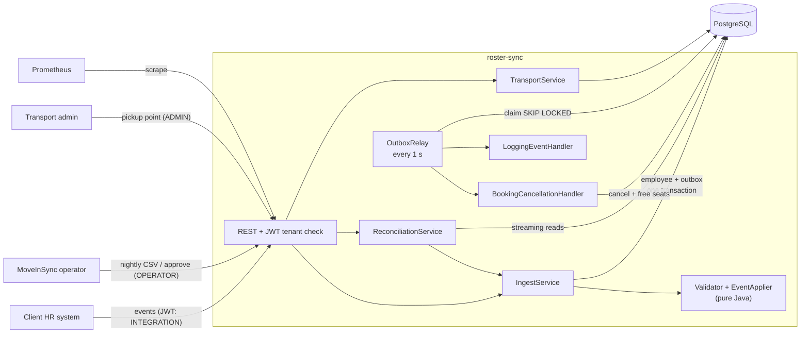
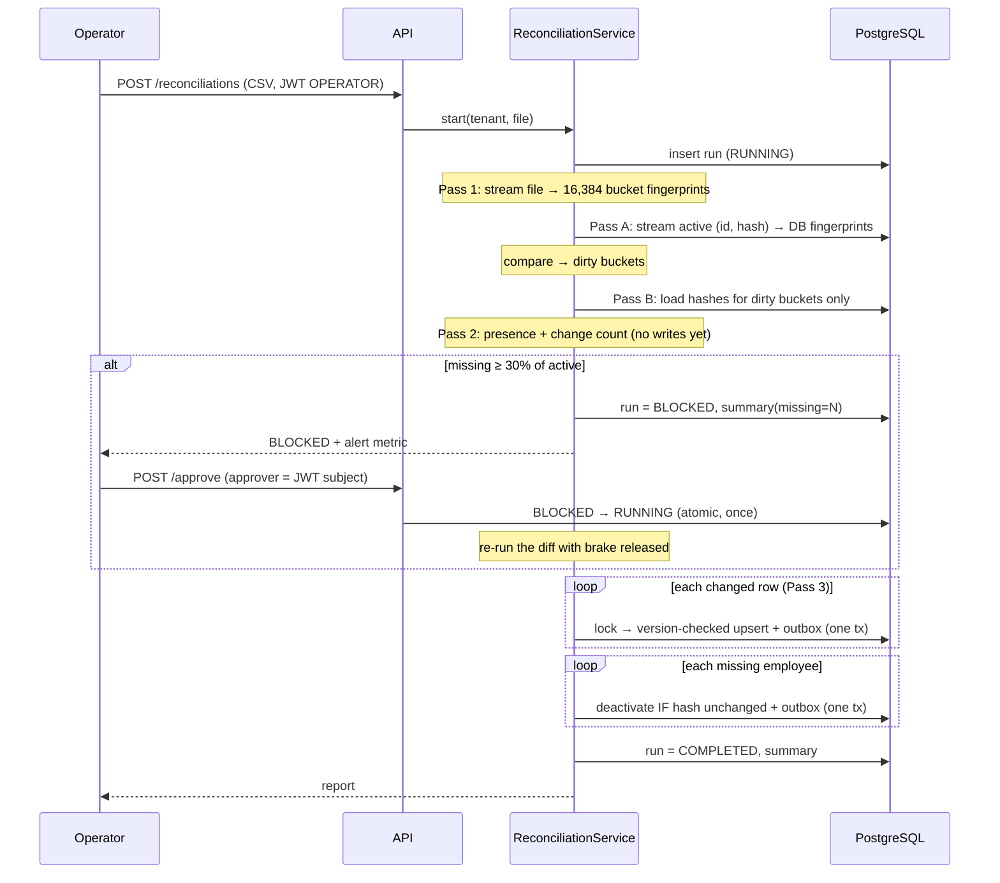

# Design note: Roster Sync

## Architecture

## Consistency model

Per employee, state converges to the event with the highest source version, regardless of
delivery order or duplication; writes for one employee are serialised by a Postgres advisory
lock, and every change commits atomically with its outbox event. HR-owned and transport-owned
fields have separate writers and separate versions, so neither can overwrite the other.
Downstream consumers are eventually consistent: events are delivered at least once, normally
within ~1 s (`roster_outbox_lag_seconds`), and consumers are idempotent, giving an exactly-once
effect. Reconciliation never deactivates on stale information: each deactivation is
conditional on the row being unchanged since the diff.

## Hardest flow: nightly reconciliation with the safety brake

## Failure modes

| What fails | What the user sees | How the system recovers |
|---|---|---|
| Duplicate or replayed HR event | `DUPLICATE` in batch result; nothing changes | Version check; no event published |
| Events arrive out of order | Older event reported `STALE` | Highest version wins; tombstones block late CREATE after DEACTIVATE |
| Malformed record in a batch | That record `REJECTED` with field codes; rest applied | Per-record validation and transactions |
| App crashes after commit, before publish | Nothing; downstream briefly behind | Relay finds unpublished row on restart and publishes it |
| App crashes mid-transaction | Request fails; HR retries | Transaction rolls back employee + outbox together; retry is idempotent |
| Consumer fails (e.g., booking DB error) | Leaver's bookings cancelled a few seconds late | Savepoint rollback, retry with attempts count; dead-letter after 5 + alert |
| Event delivered twice | Nothing | Consumers idempotent (only CONFIRMED bookings are cancelled) |
| Nightly file truncated | Run `BLOCKED`, operator alerted with missing count | No writes made; human approves or discards |
| HR updates an employee during reconciliation | Nothing | Deactivation is conditional on unchanged hash; skipped and counted |
| Postgres down | API returns 500 / health DOWN; records not lost on HR side | Fail fast; HR retries once DB is back; idempotent |
| Two relay instances | Nothing | `FOR UPDATE SKIP LOCKED`: each row claimed by one relay |
| Token for another tenant | 403 | Tenant claim checked against URL on every request |